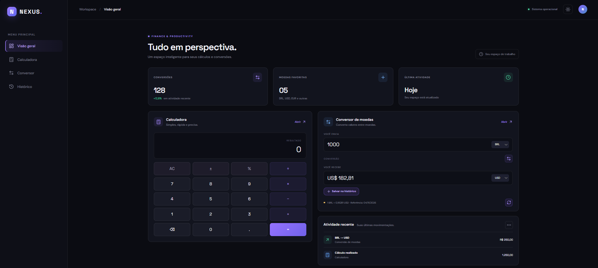
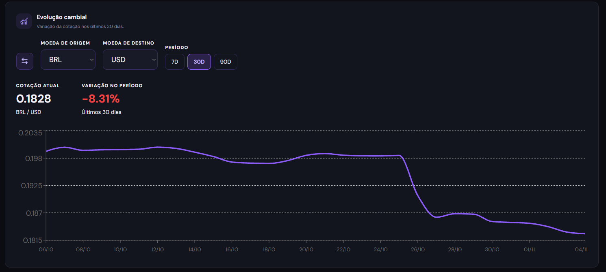
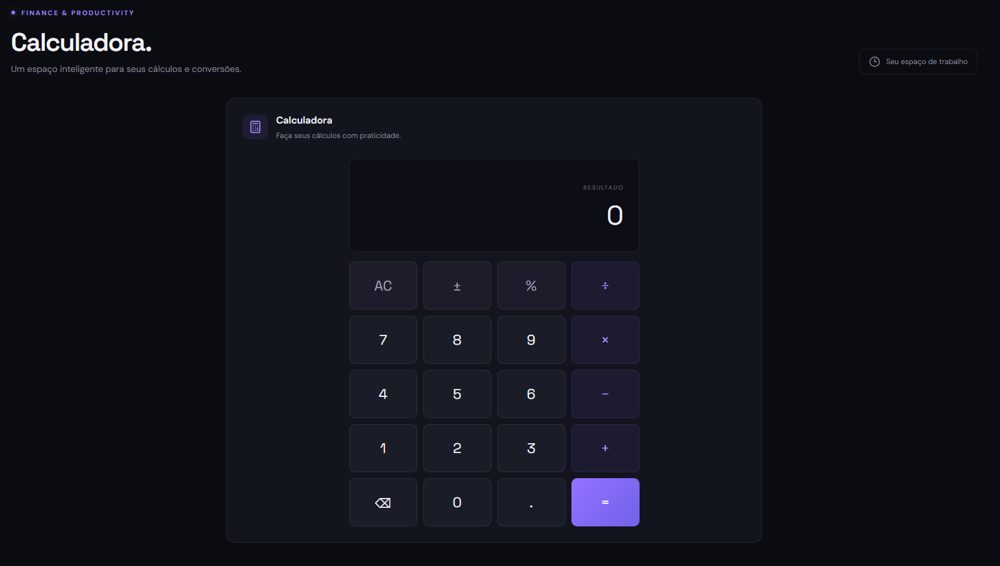

# NEXUS — Calculadora e Conversor de Moedas

O NEXUS é uma aplicação web que reúne calculadora, conversor de moedas e acompanhamento de cotações em uma única interface.

Desenvolvi este projeto com o objetivo de praticar e aprimorar meus conhecimentos em desenvolvimento web, principalmente com React e JavaScript.

## Demonstração online

Acesse o projeto: [NEXUS — GitHub Pages](https://raffaelcrespo.github.io/nexus-calculator/)

## Capturas de Tela

### Dashboard



### Evolução Cambial



### Calculadora



## Funcionalidades

- **Calculadora:** realização de operações matemáticas por meio de uma interface interativa.
- **Conversor de Moedas:** conversão entre diversas moedas utilizando cotações reais.
- **Gráfico de Cotações:** visualização da variação cambial em diferentes períodos (7, 30 e 90 dias).
- **Histórico de Conversões:** registro das conversões realizadas.
- **Dashboard:** painel com indicadores e atividades recentes.
- **Tema Claro e Escuro:** alternância entre os temas da aplicação.
- **Design Responsivo:** interface adaptada para computadores e dispositivos móveis.

## Tecnologias Utilizadas

- React
- JavaScript
- HTML5
- CSS3
- Vite
- Recharts
- Lucide React
- Framer Motion
- Frankfurter API

## Como executar o projeto

**1. Clone o repositório**

```bash
git clone https://github.com/RaffaelCrespo/nexus-calculator.git
```

**2. Acesse a pasta do projeto**

```bash
cd nexus-calculator
```

**3. Instale as dependências**

```bash
npm install
```

**4. Inicie o servidor de desenvolvimento**

```bash
npm run dev
```

Depois, acesse no navegador o endereço local disponibilizado pelo Vite.

## API de Cotações

Os dados de câmbio são obtidos por meio da [Frankfurter API](https://frankfurter.dev/).

## Desenvolvedor

**Raffael Crespo**

- GitHub: [@RaffaelCrespo](https://github.com/RaffaelCrespo)

---

Desenvolvido por Raffael Crespo · 2026